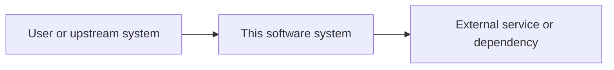
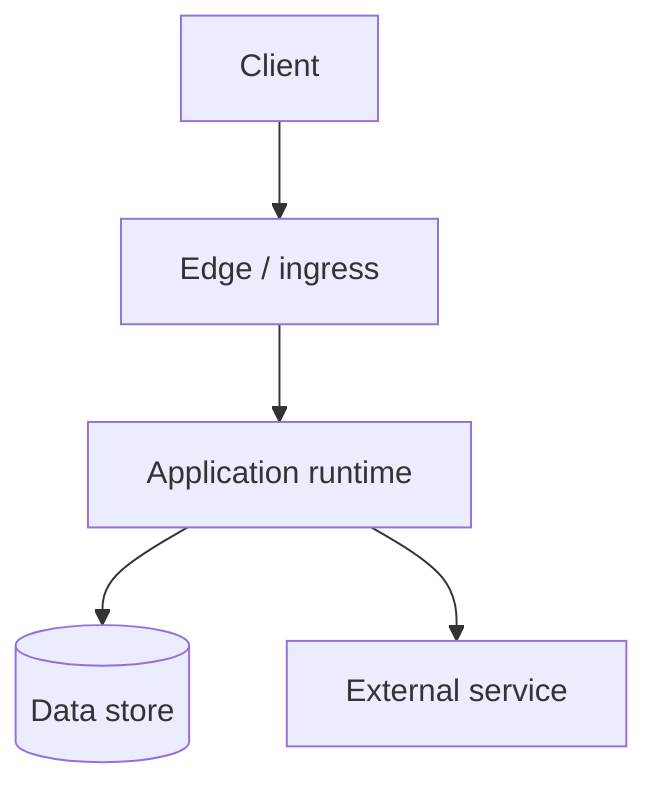
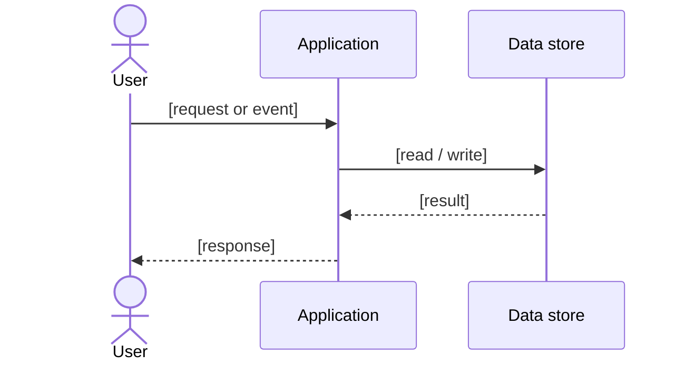

# Software Architecture Map

> Last reviewed: [YYYY-MM-DD]
> Repository: [owner/repository] | Branch: [branch] | Commit: [short SHA]
> Review scope: [apps, packages, workflows, or user journeys inspected]
> Confidence: [high / medium / low, with reason]

## Project at a glance

- **Product purpose:** [What the software does and who uses it]
- **System boundary:** [What is inside this repository and what is external]
- **Delivery status:** [Verified working areas, partial areas, and unknowns]
- **Primary language/runtime:** [Languages, runtime versions, frameworks]
- **Applications/packages:** [Web, mobile, API, workers, shared libraries, infrastructure]
- **Quality attributes:** [Availability, latency, privacy, accessibility, scale, or other explicit requirements]

## Architecture

### Architecture summary
[Describe the architecture from inspected code and deployment configuration. Separate verified facts from inference.]

### System context

Replace the example nodes and edges with the actual system boundary. Label protocols or trust boundaries where they matter.

### Runtime / deployment topology

Document deployment environments, network boundaries, regions, scaling, and single points of failure only when verified.

### Components and responsibilities

| Component | Path / deployment unit | Responsibility | Inputs / outputs | Depends on |
|---|---|---|---|---|
| [Component] | [`path/`] | [Role] | [Contracts] | [Dependencies] |

### Architectural decisions and constraints

- **Decision / constraint:** [Description, source, evidence, and consequences]
- **Compatibility requirements:** [Supported clients, API versions, runtimes, or data formats]

## Repository structure

| Path | Layer / package | Responsibility | Key entry points | Notes |
|---|---|---|---|---|
| `...` | [app / domain / infra / tests / docs] | [...] | [...] | [...] |

Include important source, tests, configuration, CI, migration, deployment, and generated/vendor boundaries. Do not dump a raw file listing without explaining ownership or purpose.

## Important flows

### [User journey or system flow]

1. **Entry:** [route, command, event, or scheduled trigger]
2. **Validation / authorization:** [middleware, policy, permission check]
3. **Domain logic:** [modules and decisions]
4. **State / side effects:** [database, queue, cache, external API]
5. **Result / failure behavior:** [response, retry, error mapping, observability]

Duplicate the flow section for other critical paths such as authentication, background processing, billing, or data export/deletion.

## Data and integrations

### Data model and lifecycle

| Entity / dataset | Owner | Storage | Sensitivity | Retention / deletion | Schema or migration path |
|---|---|---|---|---|---|
| [Entity] | [Service/package] | [Store] | [Classification] | [Policy or unknown] | [`path/to/schema`] |

Describe source of truth, consistency/transaction boundaries, migrations, backups, and recovery only when supported by evidence.

### External integrations

| Service | Direction / protocol | Purpose | Authentication mechanism (name only) | Failure / retry behavior |
|---|---|---|---|---|
| [Service] | [inbound/outbound; HTTP, queue, SDK] | [...] | [credential type or role; never value] | [...] |

### Configuration

List environment-variable and secret names only, with purpose and where they are read. Never include values, tokens, private keys, or production identifiers.

## Development and operations

- **Prerequisites:** [Tool/runtime versions and required local services]
- **Install:** [Exact command and whether verified]
- **Run locally:** [Exact command and whether verified]
- **Build / lint / typecheck:** [Exact commands and results]
- **Tests:** [Unit, integration, contract, end-to-end commands; note skipped checks]
- **CI workflows:** [Triggers, jobs, permissions, required checks]
- **Deploy / release:** [Pipeline, environments, migrations, rollback]
- **Observability:** [Logs, metrics, traces, alerts, dashboards]
- **Operational risks:** [Backups, rate limits, capacity, recovery, known gaps]

## Tests and known gaps

| Area / behavior | Evidence and test path | Status | Coverage gap / next validation |
|---|---|---|---|
| [Behavior] | [`tests/...`] | [verified / partial / not tested] | [...] |

Distinguish a test that exists from a test that was actually run. Record failures and unavailable dependencies explicitly.

## Risks and limitations

| Risk | Severity | Evidence | Impact | Mitigation / owner / open question |
|---|---|---|---|---|
| [Risk] | [high / medium / low / unknown] | [`path` or test] | [...] | [...] |

Include security boundaries, authorization, sensitive-data handling, dependency risks, migration/deletion behavior, reliability, and deployment risks when relevant. Do not turn speculation into a confirmed vulnerability.

## Inspection notes

- **Files/paths inventoried:** [scope]
- **Files/flows inspected in depth:** [scope]
- **Checks run:** [exact commands and outcomes]
- **Not inspected / could not verify:** [limitations]
- **Assumptions:** [explicitly label as inference]
- **Next review trigger:** [major architectural change, migration, release, or date]
